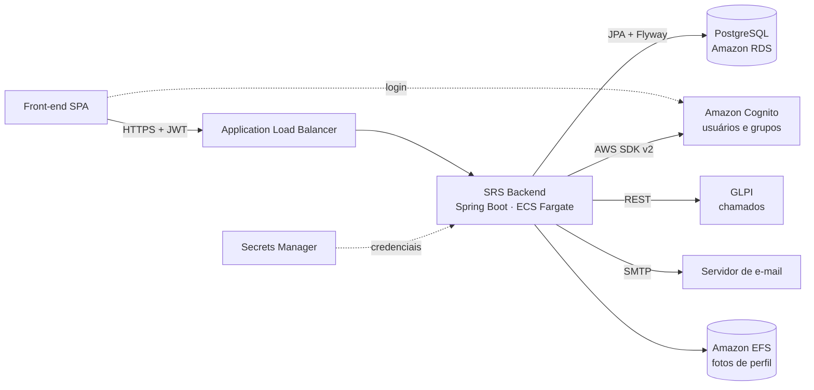
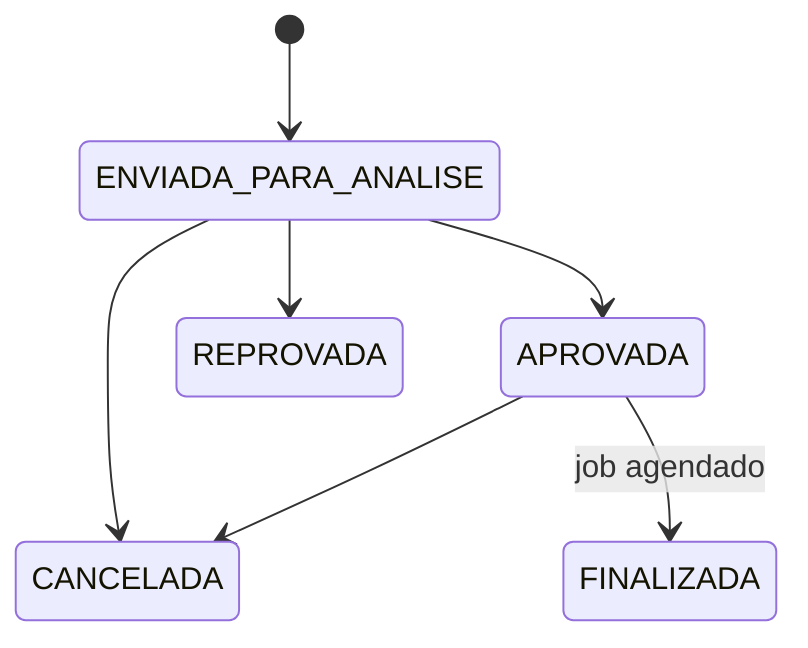

# SRS — Sistema de Reservas (Backend)


API REST de um sistema de reservas corporativo: **auditório**, **salas de reunião** e **veículos da frota**, com fluxo de aprovação por perfil, notificações por e-mail, abertura automática de chamado no GLPI e administração de usuários e grupos no AWS Cognito.

O projeto foi desenvolvido para uso interno da Secretaria Municipal de Infraestrutura Urbana e Obras (SIURB) da Prefeitura de São Paulo. Este repositório contém apenas o backend. O [front-end (SPA)](https://github.com/Felipehy/SRS-FrontEnd) é um projeto separado.

---

## Sumário

- [Funcionalidades](#funcionalidades)
- [Destaques técnicos](#destaques-técnicos)
- [Arquitetura](#arquitetura)
- [Stack](#stack)
- [Estrutura do projeto](#estrutura-do-projeto)
- [Como rodar localmente](#como-rodar-localmente)
- [Testes](#testes)
- [Rodando com Docker](#rodando-com-docker)
- [Deploy na AWS](#deploy-na-aws)
- [Autenticação e autorização](#autenticação-e-autorização)
- [Endpoints](#endpoints)
- [Regras de negócio](#regras-de-negócio)
- [E-mails (padrão outbox)](#e-mails-padrão-outbox)
- [Banco de dados](#banco-de-dados)
- [Autor](#autor)

---

## Funcionalidades

- Reserva de **auditório** (com público externo, telão, som e coffee break), **salas de reunião** (uma por andar) e **veículos da frota** (carro ou van, com ida, volta e motorista).
- **Fluxo de aprovação**: toda reserva nasce "em análise" e é aprovada ou reprovada pela divisão responsável. O coffee break tem aprovação própria.
- **Validações de agenda**: conflito de horário, intervalo mínimo entre reservas, antecedência máxima, horário comercial e justificativas obrigatórias.
- **Notificações por e-mail** em cada mudança de status, com templates HTML.
- **Integração com o GLPI**: aprovar um auditório abre automaticamente um chamado para a equipe de suporte.
- **Administração no Cognito**: criar, editar e remover usuários, resetar senha e MFA, gerenciar grupos e membros.
- **Finalização automática**: um job agendado marca como finalizadas as reservas aprovadas que já terminaram.
- **Log de auditoria**: toda ação de escrita registra o usuário, os grupos, o IP de origem e o registro afetado.
- **Perfil do usuário**: foto (JPEG/PNG), cores do calendário, layout da barra de navegação e tutorial de primeiro acesso.

## Destaques técnicos

- **Conflito barrado também no banco**: além da validação na aplicação, uma *exclusion constraint* do PostgreSQL (`EXCLUDE USING gist` com `tsrange`, migration V42) impede duas reservas **aprovadas** com horários sobrepostos, mesmo sob concorrência.
- **Outbox de e-mails**: a mensagem é gravada na mesma transação da reserva e enviada depois por um worker, com *retry* em backoff exponencial, limite de tentativas e chave de idempotência. Se o SMTP cair, nenhuma reserva é perdida. O envio pode ser desligado em tempo de execução, sem novo deploy.
- **Segurança stateless com JWT do Cognito**: OAuth2 Resource Server valida assinatura (JWKS), emissor e expiração. Os grupos do Cognito viram roles do Spring Security, checadas com `@PreAuthorize`. Também aceita o token injetado pelo Application Load Balancer.
- **Perfil `dev` sem AWS**: um filtro injeta um usuário fictício autenticado e implementações *fake* substituem o Cognito, permitindo rodar tudo localmente só com PostgreSQL.
- **Upload seguro**: só JPEG/PNG (PNG é convertido para JPEG), com proteção contra *path traversal*.
- **Exclusão lógica de usuários** com índice único parcial (`WHERE deleted_at IS NULL`), permitindo recadastrar um e-mail removido.
- **Fuso horário consistente**: regras de negócio sempre em `America/Sao_Paulo` e datas gravadas como `timestamptz`, mesmo com o container em UTC.
- **CI/CD**: GitHub Actions com autenticação OIDC na AWS (sem chaves estáticas), imagem no ECR e deploy no ECS Fargate. Imagem Docker multi-stage, executada com usuário sem privilégios.
- **Mais de 800 testes** (JUnit 5, Mockito, `@WebMvcTest`, `@DataJpaTest`, Spring Security Test).

## Arquitetura



## Stack

| Camada | Tecnologia |
|---|---|
| Linguagem | Java 21 |
| Framework | Spring Boot 4.1 (Web MVC, Data JPA, Security, Validation, Mail, Thymeleaf, Actuator) |
| Banco | PostgreSQL, migrations com Flyway |
| Autenticação | OAuth2 Resource Server com JWT do AWS Cognito |
| Integrações | AWS SDK v2 (Cognito Identity Provider), API REST do GLPI, SMTP |
| Mapeamento | MapStruct e Lombok |
| Testes | JUnit 5, Mockito, Spring Boot Test, Spring Security Test |
| Infra | Docker, Amazon ECR, ECS Fargate, RDS, EFS, Secrets Manager, GitHub Actions |

## Estrutura do projeto

```
src/main/java/com/siurbinfo/srs
├── config/        CORS por perfil, agendamento e fuso horário
├── controller/    endpoints REST
├── dto/           records de request e response
├── entity/        entidades JPA
├── enums/         status, tipos de reserva e de veículo
├── exception/     exceções de domínio e GlobalExceptionHandler (ProblemDetail)
├── mapper/        mappers MapStruct
├── repository/    repositórios Spring Data e projections
├── security/      SecurityConfig (prod), DevSecurityConfig e FakeJwtFilter (dev)
└── service/       regras de negócio, validators, e-mail, GLPI, Cognito e anexos

src/main/resources
├── db/migration/     migrations Flyway
├── templates/email/  templates Thymeleaf dos e-mails
└── static/img/       logo usada nos e-mails

.aws/task-definition.json      modelo da task definition do ECS
.github/workflows/deploy.yml   pipeline de deploy
```

---

## Como rodar localmente

O perfil `dev` dispensa AWS: o usuário logado é fictício e o Cognito é simulado. Só é preciso um PostgreSQL.

### Pré-requisitos

- JDK 21 ou superior (o Maven Wrapper do projeto baixa o Maven sozinho)
- Docker, para subir o PostgreSQL (ou um PostgreSQL 14+ próprio, com permissão para criar a extensão `btree_gist`)

### 1. Suba o banco

```bash
docker run -d --name srs-db -p 5432:5432 \
  -e POSTGRES_DB=srs -e POSTGRES_USER=srs -e POSTGRES_PASSWORD=srs \
  postgres:16
```

### 2. Crie a configuração do perfil dev

Crie o arquivo `src/main/resources/application-dev.yaml`. Ele já está no `.gitignore` e não deve ser commitado.

```yaml
server:
  port: 3000

spring:
  datasource:
    url: jdbc:postgresql://localhost:5432/srs
    username: srs
    password: srs
  jpa:
    hibernate:
      ddl-auto: validate
  mail:
    host: localhost
    port: 1025
    username: srs@localhost
    password: dev
    properties:
      mail.smtp.auth: true
      mail.smtp.starttls.enable: true

app:
  fake-user:
    email: dev@example.com
    given-name: Dev
    family-name: Local
    groupCognito: siurb-administrador,siurb-usuario-geral-especial
    groupName: Administrador
    colorGroup: "#ffffff"
    description: Usuário de desenvolvimento
  efs:
    base-path: ./anexos
  glpi:
    full-session-url: true
    authorization: user_token dev
    app-token: dev
    uri: http://localhost:9999/apirest.php
  mail:
    sender: dev@example.com
    frota: frota@example.com
    reserva: reservas@example.com
    dispatch:
      enabled: false
  url: http://localhost:5173/
```

Os grupos em `app.fake-user.groupCognito` definem as permissões do usuário fictício. Troque-os para testar outros perfis de acesso (veja [Autenticação e autorização](#autenticação-e-autorização)).

### 3. Suba a API

Linux / macOS:

```bash
./mvnw spring-boot:run -Dspring-boot.run.profiles=dev
```

Windows (PowerShell):

```powershell
.\mvnw.cmd spring-boot:run "-Dspring-boot.run.profiles=dev"
```

Na primeira subida o Flyway cria todas as tabelas. A API fica em `http://localhost:3000`.

### 4. Cadastre o usuário de dev no banco

As reservas são vinculadas a uma linha de `tbl_user`. No perfil dev não há Cognito para criar usuários, então insira o usuário fictício manualmente (com a API já tendo subido uma vez):

```bash
docker exec -it srs-db psql -U srs -d srs -c \
  "INSERT INTO tbl_user (email, given_name, family_name) VALUES ('dev@example.com', 'Dev', 'Local');"
```

### 5. Teste

```bash
curl http://localhost:3000/actuator/health
curl http://localhost:3000/api/user
curl http://localhost:3000/api/room
```

Criando uma reserva de sala de reunião (use um `roomId` retornado por `GET /api/room`, o `id` do usuário criado no passo 4 e uma data de hoje ou futura):

```bash
curl -X POST http://localhost:3000/api/reservation/meeting-room \
  -H "Content-Type: application/json" \
  -d '{
        "reservationDate": "2026-12-01",
        "roomId": 11,
        "startTime": "09:00",
        "endTime": "10:00",
        "userNameRequester": "Dev Local",
        "requesterDepartment": "TI",
        "numPeople": 4,
        "isCoffee": false,
        "userId": 1
      }'

curl http://localhost:3000/api/reservation/meeting-room
curl -X POST http://localhost:3000/api/reservation/meeting-room/1/approve
```

### E-mails em desenvolvimento

Com `app.mail.dispatch.enabled: false` os e-mails são gravados na outbox, mas não são enviados. Para vê-los de verdade, suba um SMTP de testes como o [Mailpit](https://mailpit.axllent.org/) e mude a flag para `true`:

```bash
docker run -d --name mailpit -p 1025:1025 -p 8025:8025 \
  -e MP_SMTP_AUTH_ACCEPT_ANY=1 -e MP_SMTP_AUTH_ALLOW_INSECURE=1 \
  axllent/mailpit
```

As mensagens aparecem em `http://localhost:8025`.

### Limitações do perfil dev

- Criar, editar e remover usuários, resetar senha e MFA e alterar membros de grupos retornam erro, porque dependem do Cognito.
- O GLPI não tem versão simulada: **aprovar um auditório** chama a API configurada em `app.glpi.uri` e falha se ela não existir. Salas de reunião e veículos funcionam normalmente.

---

## Testes

A suíte usa o perfil `test`. Os testes de repositório e de serviço rodam contra um **PostgreSQL real**, não H2, porque as migrations usam recursos específicos do PostgreSQL.

1. Crie o banco de testes:

   ```bash
   docker exec srs-db createdb -U srs srs_test
   ```

2. Crie `src/test/resources/application-test.properties` (também no `.gitignore`):

   ```properties
   spring.datasource.url=jdbc:postgresql://localhost:5432/srs_test
   spring.datasource.username=srs
   spring.datasource.password=srs
   spring.jpa.hibernate.ddl-auto=validate
   spring.mail.host=localhost
   spring.mail.port=1025
   spring.mail.username=test@example.com
   spring.mail.password=test
   app.url=http://localhost:5173/
   app.mail.sender=
   app.mail.frota=frota@example.com
   app.mail.reserva=reservas@example.com
   app.mail.dispatch.enabled=false
   app.glpi.full-session-url=true
   app.glpi.authorization=test
   app.glpi.app-token=test
   app.glpi.uri=http://localhost:9999/apirest.php
   app.efs.base-path=./target/anexos-test
   ```

   `app.mail.dispatch.enabled=false` desliga o worker de e-mails, para nenhum teste mexer na outbox do banco de testes. GLPI e SMTP recebem valores fictícios porque são mockados.

3. Garanta que o `application-dev.yaml` do passo 2 da seção anterior existe: um dos testes valida que ele define todas as propriedades do usuário fictício.

4. Rode `./mvnw test` (Linux / macOS) ou `.\mvnw.cmd test` (Windows).

---

## Rodando com Docker

A imagem roda o perfil `prod`, que lê toda a configuração de variáveis de ambiente. Nenhum segredo fica no código ou na imagem.

```bash
docker build -t srs-backend .
cp .env.example .env
docker run --rm -p 8080:8080 --env-file .env srs-backend
```

Preencha o `.env` antes de subir. Ele está no `.gitignore` e no `.dockerignore`. Em Linux, para o container enxergar um PostgreSQL rodando no host, adicione `--add-host=host.docker.internal:host-gateway`.

O build é multi-stage (Maven com JDK 21 para compilar, JRE 21 para executar) e pula os testes, que dependem de um banco.

### Variáveis de ambiente

| Variável | Descrição |
|---|---|
| `SPRING_PROFILES_ACTIVE` | `prod` |
| `SPRING_DATASOURCE_URL` | JDBC do PostgreSQL, ex.: `jdbc:postgresql://<host>:5432/<db>?currentSchema=db_srs` |
| `SPRING_DATASOURCE_USERNAME` / `SPRING_DATASOURCE_PASSWORD` | Credenciais do banco |
| `COGNITO_ISSUER_URI` | Issuer do User Pool: `https://cognito-idp.<regiao>.amazonaws.com/<user-pool-id>`. A região e o ID do pool usados pelo AWS SDK são extraídos dessa URL |
| `SPRING_TEMPORARY_PASSWORD` | Senha temporária atribuída a usuários criados ou com senha resetada |
| `AWS_ACCESS_KEY_ID` / `AWS_SECRET_ACCESS_KEY` | Só fora da AWS: credenciais com permissão de administração no User Pool. No ECS vêm da task role |
| `SMTP_SERVER`, `SMTP_PORT`, `SMTP_USER`, `SMTP_PASSWORD` | Servidor de e-mail (STARTTLS) |
| `GLPI_API_URL` | URL da API REST do GLPI, ex.: `https://<host>/apirest.php` |
| `SPRING_FOREIGN_API_GLPI_GET_FULL_SESSION` | Header `get_full_session` da API do GLPI |
| `SPRING_FOREIGN_API_AUTHORIZATION` | Header `Authorization` da API do GLPI |
| `SPRING_FOREIGN_API_GLPI_APP_TOKEN` | Header `App-Token` da API do GLPI |
| `APP_FRONTEND_URL` | URL do front-end, usada no botão "Acompanhar" dos e-mails |
| `CORS_ALLOWED_ORIGINS` | Origens liberadas no CORS, separadas por vírgula |
| `MAIL_FLEET_ADDRESS` / `MAIL_RESERVATION_ADDRESS` | Caixas que recebem cópia das solicitações de frota e de salas/auditório |
| `APP_EFS_BASE_PATH` | Diretório das fotos de perfil. Padrão `/app/anexos`, onde o EFS é montado no ECS |

---

## Deploy na AWS

A aplicação roda no **ECS Fargate** atrás de um **Application Load Balancer**, com banco no **RDS PostgreSQL**, fotos no **EFS** e segredos no **Secrets Manager**.

### Recursos necessários

| Recurso | Uso |
|---|---|
| Repositório ECR `srs-backend` | Imagens da aplicação |
| Cluster e serviço ECS (Fargate) | Execução do container na porta 8080 |
| RDS PostgreSQL | Banco. O Flyway cria o schema `db_srs` na primeira subida |
| Cognito User Pool | Usuários e grupos (veja os grupos abaixo). O app client precisa emitir access tokens com o escopo `aws.cognito.signin.user.admin` |
| Secrets Manager | Credenciais do banco, SMTP, GLPI e senha temporária |
| EFS montado em `/app/anexos` | Fotos de perfil, persistidas entre deploys |
| ALB | Termina o HTTPS e encaminha para o serviço. Health check em `/actuator/health` |
| IAM | Execution role com `secretsmanager:GetSecretValue`, task role com permissões de administração do User Pool e role do GitHub Actions (OIDC) com acesso ao ECR e ao ECS |

### Primeiro deploy

1. Crie os segredos no Secrets Manager e preencha os placeholders `<...>` de `.aws/task-definition.json` (ID da conta, ID do User Pool, nomes dos segredos, domínio do front, host do banco e do GLPI e caixas de e-mail).
2. Registre a task definition e crie o serviço:

   ```bash
   aws ecs register-task-definition --cli-input-json file://.aws/task-definition.json
   aws ecs create-service --cluster <cluster> --service-name srs-backend-service \
     --task-definition srs-backend --launch-type FARGATE --desired-count 1 \
     --network-configuration "awsvpcConfiguration={subnets=[<subnet>],securityGroups=[<sg>]}" \
     --load-balancers "targetGroupArn=<target-group-arn>,containerName=srs-backend,containerPort=8080"
   ```

3. No GitHub, em **Settings → Secrets and variables → Actions → Variables**, crie a variável `AWS_DEPLOY_ROLE_ARN` com o ARN da role que o GitHub Actions vai assumir. Sem ela, o workflow de deploy é ignorado.
4. Ajuste em `.github/workflows/deploy.yml` a região, o cluster e o serviço, se forem diferentes.

### Pipeline

Cada push na branch `main` dispara `.github/workflows/deploy.yml`, que:

1. autentica na AWS via OIDC, sem chaves estáticas;
2. builda a imagem e publica no ECR com a tag do commit;
3. baixa a task definition atual do ECS e troca apenas a imagem;
4. faz o deploy no serviço e espera ele estabilizar.

---

## Autenticação e autorização

Cada grupo do Cognito (claim `cognito:groups`) vira uma role `ROLE_<grupo>`, checada com `@PreAuthorize`. O token é lido do header `Authorization: Bearer <token>` ou, como alternativa, do header `x-amzn-oidc-accesstoken` injetado pelo ALB.

| Grupo | Acesso |
|---|---|
| `siurb-administrador` | Tudo, incluindo usuários, grupos, departamentos, salas, logs e SMTP |
| `siurb-divisao-administrativa` | Aprovar, reprovar, editar e excluir reservas de auditório e de sala, aprovar e reprovar coffee break, editar reservas de veículo |
| `siurb-divisao-frotas` | Aprovar, reprovar e excluir reservas de veículo e gerenciar motoristas |
| `siurb-usuario-geral-especial` | Cria reservas sem as regras de intervalo, conflito e antecedência |
| Qualquer usuário autenticado | Criar, consultar e cancelar as próprias reservas e editar o próprio perfil |

## Endpoints

Todas as rotas exigem autenticação, exceto `GET /actuator/health` e o preflight `OPTIONS`. Os erros seguem o formato `ProblemDetail` (RFC 9457).

### Reservas

Base: `/api/reservation/auditorium`, `/api/reservation/meeting-room` e `/api/reservation/fleet-vehicle`.

| Método | Rota | Descrição | Restrição |
|---|---|---|---|
| `POST` | `/` | Cria reserva | |
| `GET` | `/` | Lista reservas | |
| `GET` | `/?year=&month=` | Lista reservas do mês | |
| `GET` | `/{id}` | Detalha reserva | |
| `POST` | `/cancel` | Cancela reserva (`id` e motivo no corpo) | Dono da reserva, administrativa ou admin |
| `POST` | `/{id}/approve` | Aprova | Administrativa (auditório e sala), Frotas (veículo) |
| `POST` | `/{id}/reject` | Reprova (motivo no corpo) | Administrativa (auditório e sala), Frotas (veículo) |
| `PUT` | `/{id}` | Edita | Administrativa |
| `DELETE` | `/{id}` | Exclui | Administrativa (auditório e sala), Frotas (veículo) |
| `POST` | `/approve-coffee?id=` | Aprova coffee break | Administrativa, só auditório e sala |
| `POST` | `/reject-coffee?id=` | Reprova coffee break | Administrativa, só auditório e sala |

`GET /api/reservation?startTime=&endTime=` devolve as reservas dos três tipos no período.

### Demais recursos

| Recurso | Rotas |
|---|---|
| Usuário logado | `GET /api/user`, `POST /api/user?navbar=`, `POST /api/user/color`, `GET /api/user/reservations`, `PATCH /api/user/tutorial` |
| Admin: usuários | `GET /api/admin/list-users`, `POST/PATCH/DELETE /api/admin/user`, `POST /api/admin/reset-password`, `POST /api/admin/reset-mfa`, `POST /api/admin/department` |
| Admin: grupos | `GET /api/admin/list-group`, `POST/PATCH/DELETE /api/admin/group`, `POST /api/admin/user/groups`, `POST /api/admin/groups/users`, `POST /api/admin/user/add-group`, `POST /api/admin/user/remove-group` |
| Departamentos | `GET/POST/PATCH/DELETE /api/department`, `GET /api/department/{id}` |
| Motoristas | `GET/POST /api/driver`, `GET/PUT/DELETE /api/driver/{id}` |
| Salas | `GET /api/room`, `GET /api/room/{id}`, `PATCH /api/room?id=&isActive=` |
| Foto de perfil | `POST /api/anexos` (multipart, JPEG/PNG), `GET /api/anexos/img`, `GET /api/anexos/imgs?email=`, `DELETE /api/anexos/delete` |
| Logs de auditoria | `GET /api/logs?offset=` |
| SMTP | `GET /api/smtp`, `POST /api/smtp?active=` (liga e desliga o envio de e-mails) |

---

## Regras de negócio

### Ciclo de vida da reserva



- Reservas com coffee break só podem ser aprovadas depois que o café for aprovado ou reprovado.
- Ao aprovar um **auditório**, é aberto um chamado no GLPI e o número do ticket fica salvo na reserva.
- O job `FinishReservations` roda a cada 15 s, marca como `FINALIZADA` as reservas aprovadas que já terminaram e dispara o e-mail de finalização.

### Validações ao criar ou editar

| Regra | Auditório | Sala | Veículo |
|---|:-:|:-:|:-:|
| Início antes do fim | ✓ | ✓ | |
| Início a partir das 07:00 | ✓ | ✓ | |
| Término após 19:00 exige justificativa | ✓ | ✓ | |
| Intervalo mínimo após a reserva aprovada anterior do mesmo dia | 30 min | 15 min | 2 h |
| Bloqueio por conflito com reserva **aprovada** | ✓ | ✓ (mesma sala) | |
| Antecedência máxima | | | 2 dias |
| Partida diferente do destino | | | ✓ |
| Van exige 5 ou mais passageiros e justificativa | | | ✓ |
| Destino fora do município exige justificativa | | | ✓ |
| Horários de montagem e de serviço do coffee break dentro da reserva | ✓ | | |

Usuários de `siurb-usuario-geral-especial` não passam pelas regras de intervalo, conflito e antecedência.

## E-mails (padrão outbox)

1. Cada evento (solicitação, aprovação, reprovação, cancelamento, coffee break e finalização) renderiza um template Thymeleaf de `templates/email/` e grava a mensagem na tabela `outbox_email` como `PENDING`, na mesma transação da reserva.
2. O worker `EmailDispatch` roda a cada 15 s e, se o envio estiver ligado (flag em `tbl_config`, controlada por `/api/smtp`), envia as pendentes.
3. Em caso de falha, tenta de novo com backoff exponencial (2, 4, 8 e 16 min). Depois de 5 tentativas a mensagem vira `DEAD` e não é mais reenviada.
4. Uma chave de idempotência única (`reserva:tipo:status:destinatário`) impede e-mails duplicados.

## Banco de dados

As migrations ficam em `src/main/resources/db/migration` e seguem o padrão Flyway `V<n>__<descricao>.sql`. O Hibernate roda com `ddl-auto=validate`, então **toda mudança de schema precisa de uma nova migration**. Nunca altere uma migration já aplicada: o Flyway valida o checksum de cada arquivo.

---

## Autor

**Felipe Hajime Yamashita** · [LinkedIn](https://www.linkedin.com/in/felipe-hajime-yamashita/) · [GitHub](https://github.com/Felipehy)
